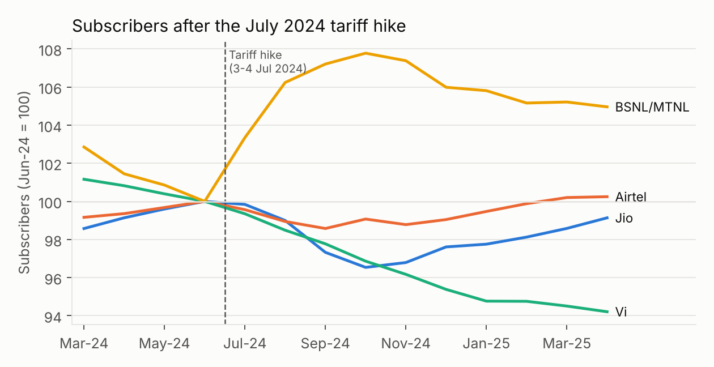
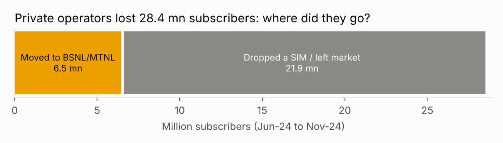
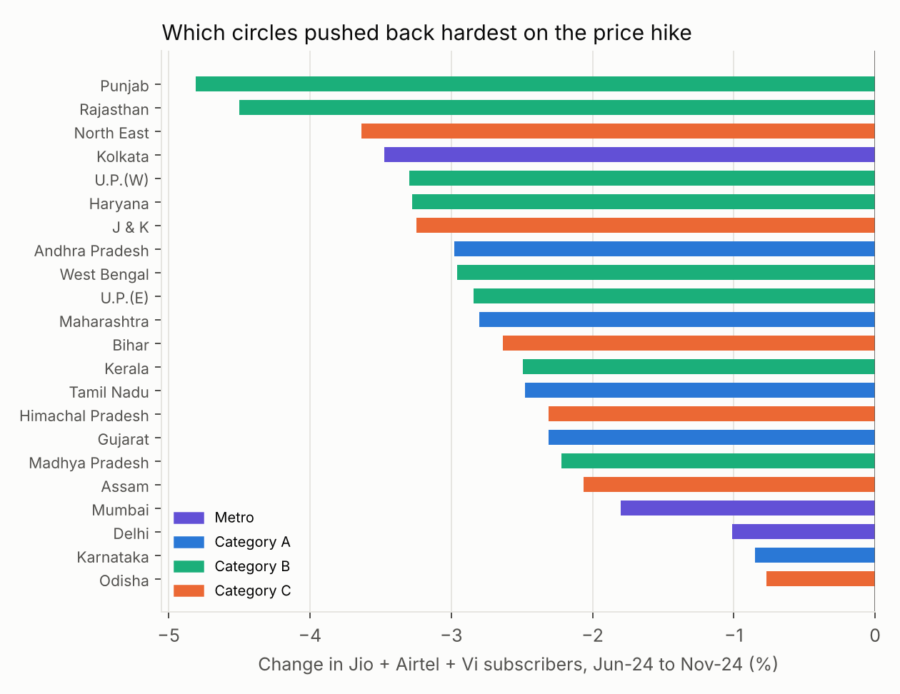
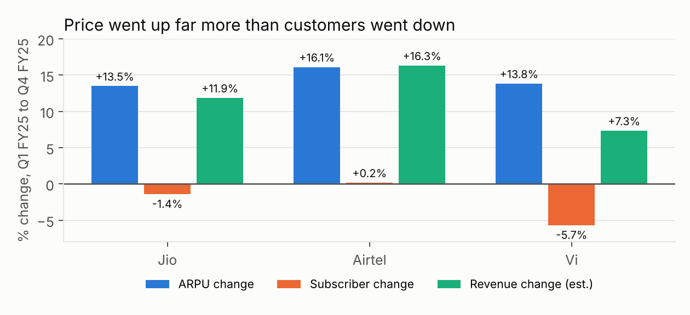

# How Much Pricing Power Do India's Telcos Really Have?
### Evidence from the July 2024 mobile tariff hike

**Question.** In early July 2024, Jio, Airtel and Vi raised mobile tariffs. Who lost customers, where, and did the price rise pay off? What does that imply for the next hike, which analysts expect at around 15%?

**Approach.** I built a month × circle × operator dataset of wireless subscribers (14 months, 22 telecom circles, 4 operator groups) from TRAI's monthly press releases, validated it against TRAI's printed totals, and combined it with company-reported ARPU. Then I measured the demand response to the price increase, overall and by region, and used it to model the next hike.

## Key findings

**1. The price rise paid off for all three private operators.** From Q1 FY25 (pre-hike) to Q4 FY25:

| | ARPU change | Subscriber change | Estimated revenue change |
|---|---|---|---|
| Airtel | +16.1% | +0.2% | **+16.3%** |
| Jio | +13.5% | −1.4% | **+11.9%** |
| Vi | +13.8% | −5.7% | **+7.3%** |

Prices rose 13–16% while subscribers fell by at most 6%, so demand was **price-inelastic**. Airtel showed the strongest pricing power: the biggest ARPU gain with no net subscriber loss.

**2. Most "lost customers" weren't lost to a competitor; people dropped a second SIM.** Between June and November 2024, Jio, Airtel and Vi lost 28.4 mn subscribers (−2.6%). Only **6.5 mn (23%)** moved to BSNL/MTNL. The other **21.9 mn (77%)** left the market entirely, which is consistent with multi-SIM users dropping their secondary SIM.

**3. The switch to BSNL was partly temporary.** BSNL/MTNL peaked at +6.8 mn subscribers in October 2024 and held on to 4.3 mn (64%) by April 2025. BSNL's subscriber base also had the lowest share of active users before the hike: 54% of its SIMs were active in June 2024, against 99% for Airtel and 93% for Jio (TRAI VLR data).

**4. Price sensitivity varied about 6× across circles.** Private-operator subscribers fell 4.8% in Punjab and 4.5% in Rajasthan, but only 0.8% in Odisha, 0.9% in Karnataka and 1.0% in Delhi. Metro circles reacted least on average (−1.7%) and Category B circles the most (−3.2%). Where BSNL already had a larger presence before the hike, it gained more share (correlation 0.38), so switching depended on having a credible cheap alternative on the ground.

**5. Recovery was uneven.** Airtel was back above its pre-hike base by March 2025, and Jio was within 0.9% by April 2025. Vi kept falling (−5.8% from June 2024 to April 2025), so its problem is structural, not just about price.

## Next-hike scenarios (15% tariff increase)
Two bounds are shown: subscriber response as observed in 2024, and as measured against each operator's pre-hike growth trend.

| | Subscriber change | Revenue change |
|---|---|---|
| Airtel | 0% to −2.2% | **+12.5% to +15.0%** |
| Jio | −1.6% to −6.4% | **+7.7% to +13.2%** |
| Vi | −2.4% to −6.2% | **+7.9% to +12.2%** |

Full table (10%, 15%, 20%): `outputs/07_next_hike_scenarios.csv`

## Recommendations
1. **Airtel is best placed to lead the next hike.** It has the lowest subscriber risk under both bounds.
2. **Protect the secondary SIM.** Most of the 2024 losses were dropped second SIMs. A low-cost "keep-my-number" plan could retain those users while the main plans carry the price increase.
3. **Phase the increase by circle.** Watch the most price-sensitive circles (Punjab, Rajasthan, UP-West, Haryana), where BSNL is a real alternative, and consider targeted offers there.
4. **Vi:** a price rise improves revenue but doesn't fix subscriber decline. It needs network and coverage investment alongside pricing.






## Data and validation
- **Subscribers:** TRAI "Telecom Subscription Data" press releases, Annexure-II (wireless subscribers by service area and operator), March 2024 to April 2025.
- **Validation:** (1) each circle's operator figures add up to TRAI's printed circle total; (2) months published in two consecutive releases match exactly; (3) the circles add up to TRAI's national total for every month, with zero difference.
- **ARPU:** company quarterly results. Q1 FY25 → Q4 FY25: Jio ₹181.7 → ₹206.2, Airtel ₹211 → ₹245, Vi ₹154 → ₹175.3 (Vi = customer ARPU excluding M2M, same definition in both quarters).

## Limitations
- TRAI counts registered SIMs, not unique customers. Some movement is SIM consolidation, which is itself one of the findings.
- The revenue estimate is TRAI subscriber count × company ARPU, a proxy. Operators define ARPU on their own customer base, so percentage changes are more reliable than rupee levels. ARPU growth also includes mix effects such as 5G upgrades and postpaid growth, not just the tariff increase.
- The trend-adjusted bound assumes pre-hike growth (Mar–Jun 2024) would have continued, which probably overstates Jio's counterfactual. That's why both bounds are reported.
- BSNL and MTNL are combined. MTNL's Delhi and Mumbai figures drop sharply in December 2024 and April 2025 (a data revision), which doesn't affect the June–November shock window.
- The circle category (Metro/A/B/C) is DoT's licence classification, used as a rough proxy for market maturity.

## Run it
```
pip install pandas numpy matplotlib
python build_dataset.py     # parses raw/ and validates -> data/trai_wireless_panel.csv
python analysis.py          # -> outputs/ (7 CSVs + 4 charts)
```
